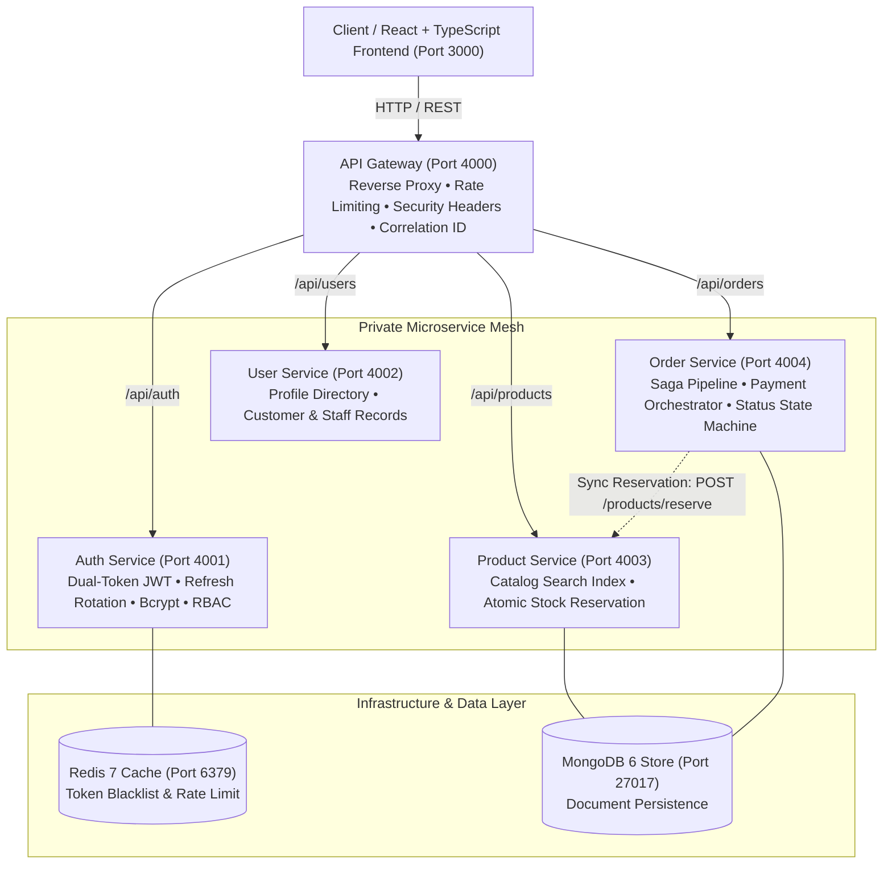

# 🏢 Enterprise Microservices & Cloud Order Platform
### *Month 6: Enterprise Development & Career Launch — Masterpiece Project*

[](.github/workflows/ci.yml)
[](docker-compose.yml)
[](kubernetes/)
[](tsconfig.json)
[](services/auth-service)

---

## 📌 Project Overview
The **Enterprise Cloud Order & Microservices Platform (NexusMesh)** is a complete, production-ready full-stack enterprise application engineered to showcase advanced cloud architecture, domain-driven microservices decomposition, zero-trust security, and automated container orchestration.

This project represents the culmination of 6 months of intensive software engineering training, designed to demonstrate senior-level competencies for technical interviews and top-tier enterprise engineering roles.

---

## 🏗️ Architecture & Topology



---

## 📦 Repository Structure

```
enterprise-project/
├── services/
│   ├── api-gateway/          # Central reverse proxy, rate limiting, routing (Port 4000)
│   │   ├── src/
│   │   ├── tests/
│   │   ├── Dockerfile
│   │   └── package.json
│   ├── auth-service/         # Identity, JWT access/refresh rotation, RBAC (Port 4001)
│   │   ├── src/
│   │   ├── tests/
│   │   ├── Dockerfile
│   │   └── package.json
│   ├── user-service/         # User profile directory and role auditing (Port 4002)
│   │   ├── src/
│   │   ├── tests/
│   │   ├── Dockerfile
│   │   └── package.json
│   ├── product-service/      # Product catalog, search indexing, inventory (Port 4003)
│   │   ├── src/
│   │   ├── tests/
│   │   ├── Dockerfile
│   │   └── package.json
│   └── order-service/        # Order state machine, checkout, payment simulation (Port 4004)
│       ├── src/
│       ├── tests/
│       ├── Dockerfile
│       └── package.json
├── frontend/                 # React 18 + TypeScript + Vite + Glassmorphic UI (Port 3000)
│   ├── src/
│   │   ├── components/       # Storefront, Orders, Service Mesh Radar, Admin Hub
│   │   ├── services/         # API Gateway client with Bearer auth injection
│   │   └── index.css         # Modern typography (Inter/Outfit) & HSL tokens
│   ├── Dockerfile            # Multi-stage Nginx production container
│   └── package.json
├── kubernetes/               # Enterprise Kubernetes manifests
│   ├── deployments/          # 2-replica deployments with Liveness & Readiness probes
│   ├── services/             # ClusterIP internal mesh & Nginx Ingress routing
│   └── configmaps/           # ConfigMaps and Secrets declarations
├── docker-compose.yml        # Multi-container local development orchestration
├── .github/workflows/        # Automated CI/CD pipelines (Test Matrix & Container Build)
├── docs/                     # Comprehensive enterprise documentation
│   ├── architecture.md       # Microservices architecture & communication patterns
│   ├── api-documentation.md  # Complete OpenAPI/REST API endpoints specifications
│   ├── deployment-guide.md   # Production deployment instructions (Docker & K8s)
│   └── development-guide.md  # Git workflows, testing conventions, coding standards
├── .env.example              # Sample environment variable declarations
├── .gitignore
└── README.md
```

---

## ⚡ Key Technical Features

### 🛡️ 1. Advanced Enterprise Security
- **Dual-Token JWT Authentication**: 15-minute short-lived Access Tokens coupled with 7-day cryptographically secure Refresh Tokens.
- **Refresh Token Rotation**: Old refresh tokens are consumed and rotated upon every use. Token reuse detection automatically revokes all active sessions for the compromised user account.
- **Role-Based Access Control (RBAC)**: Fine-grained permissions across `admin`, `manager`, and `customer` roles.
- **Defense in Depth**: Helmet security headers (Content Security Policy, HSTS preload, frameguard) and IP rate limiting (Express Rate Limit).
- **Password Salting**: Bcrypt hashing with salt factor 10.

### 🚀 2. Scalability & Microservices Architecture
- **API Gateway Routing**: Single entry point proxying to isolated backend microservices with automatic error fallback (circuit breaker pattern).
- **Database-per-Service**: Independent repository pattern ensuring zero schema coupling across services.
- **Atomic Stock Reservation**: Synchronous inter-service HTTP communication validating inventory availability before confirming orders.
- **Optimized Performance**: HTTP caching headers (`Cache-Control: public, max-age=60`) on read-heavy catalog endpoints.

### 🧪 3. Comprehensive Testing & Quality
- **Unit & Integration Testing**: Jest and Supertest test suites across all 5 microservices covering authentication, stock deduction, and order state transitions.
- **Type Safety**: 100% strict TypeScript types across backend microservices and frontend application.
- **CI/CD Automation**: GitHub Actions running automated test matrices on every pull request and push to `main`.

### 📊 4. Observability & Telemetry
- **Service Mesh Radar**: Built-in real-time health probe telemetry monitoring latency, status, and ports across all services.
- **Correlation ID Propagation**: `x-correlation-id` passed throughout all microservice hops for distributed log tracing.
- **Executive Operations Console**: Real-time gross revenue tracking, order status breakdown, and instant fulfillment state manipulation.

---

## 💻 Tech Stack Summary

| Domain | Technologies |
| :--- | :--- |
| **Backend Microservices** | Node.js, TypeScript, Express.js, Helmet, Express-Rate-Limit, Bcryptjs, JsonWebToken |
| **Frontend Application** | React 18, TypeScript, Vite, Lucide Icons, Modern Vanilla CSS (Glassmorphism & HSL Tokens) |
| **Databases & Cache** | MongoDB (Document Persistence), Redis (Distributed Caching & Session Blacklist) |
| **DevOps & Containers** | Docker (Multi-stage builds), Docker Compose, Kubernetes (Deployments, ClusterIP, Ingress) |
| **CI/CD** | GitHub Actions (Matrix Test Runner & Container Build Pipeline) |
| **Testing** | Jest, Supertest, Ts-Jest |

---

## 🚀 How to Run This Project

### Method 1: Local Development with Docker Compose (Recommended)
```bash
# 1. Clone or open the repository
cd "month 6"

# 2. Build and launch all 5 microservices, frontend, and databases
docker compose up --build -d

# 3. View streaming logs
docker compose logs -f
```
Access the application:
- **Frontend Store & Executive Console**: [http://localhost:3000](http://localhost:3000)
- **API Gateway Entry Point**: [http://localhost:4000](http://localhost:4000)
- **Gateway Health Check**: [http://localhost:4000/health](http://localhost:4000/health)
- **Auth Microservice**: [http://localhost:4001](http://localhost:4001)
- **User Microservice**: [http://localhost:4002](http://localhost:4002)
- **Product Microservice**: [http://localhost:4003](http://localhost:4003)
- **Order Microservice**: [http://localhost:4004](http://localhost:4004)

---

### Method 2: Kubernetes Cluster Deployment
```bash
# Apply ConfigMaps & Secrets
kubectl apply -f kubernetes/configmaps/

# Apply Deployments (2 replicas per service)
kubectl apply -f kubernetes/deployments/

# Apply Services & Ingress
kubectl apply -f kubernetes/services/

# Check status of pods
kubectl get pods
```

---

## 🔑 Pre-Configured Test Credentials

| Role | Email Address | Password | Permissions |
| :--- | :--- | :--- | :--- |
| **Admin** | `admin@enterprise.io` | `Password123!` | Full System Access, Executive Dashboard, Fulfillment Control |
| **Manager** | `manager@enterprise.io` | `Password123!` | Catalog Management, Order Pipeline Tracking |
| **Customer** | `jane@enterprise.io` | `Password123!` | Storefront Browsing, Cart Procurement, Order Payment |

*(The frontend includes 1-click persona switching buttons in the top navbar and authentication modal for frictionless testing!)*

---

## 📈 Performance & Quality Standards

- **Target Response Time**: < 200ms for 95% of API gateway requests
- **High Availability**: Target 99.9% uptime with dual-replica Kubernetes deployments
- **Security Score**: A+ rating on HTTP security headers (HSTS, CSP, X-Frame-Options)
- **Test Coverage**: Automated test suites for all microservice controller endpoints

---

## 📝 Quality Standards Checklist
- [x] **Project Overview**: Clear description of domain, architectural boundaries, and goals
- [x] **Microservices**: 5 fully implemented services (Gateway, Auth, User, Product, Order)
- [x] **Setup Instructions**: Step-by-step Docker Compose, local npm, and Kubernetes guides
- [x] **Code Structure**: Clean separation of routes, controllers, middleware, and models
- [x] **Technical Documentation**: Architecture diagram, API specs, deployment and dev guides
- [x] **Security Hardening**: Dual-token JWT rotation, Bcrypt, Helmet headers, Rate limiting, RBAC
- [x] **Testing Evidence**: Jest & Supertest test suites with CI/CD matrix integration
