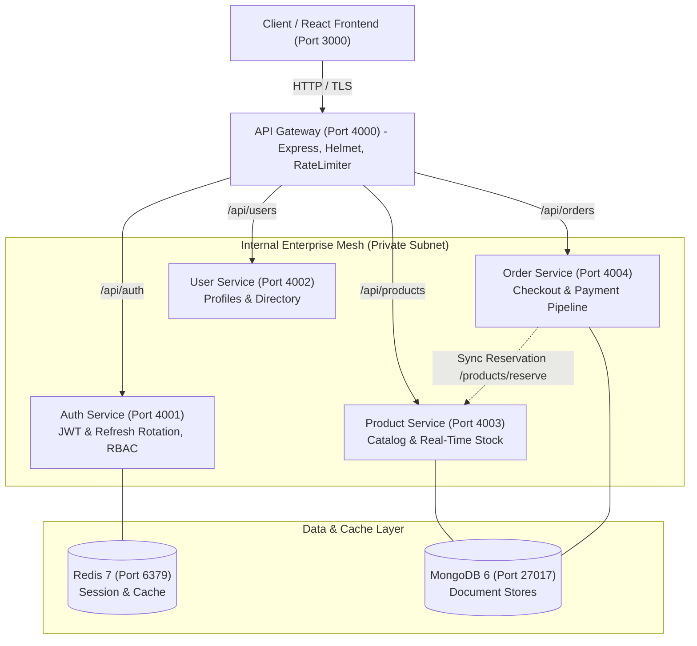

# Enterprise Microservices Platform Architecture

## Executive Overview
The **Enterprise Cloud Platform** is an enterprise-grade, distributed e-commerce and order orchestration platform engineered with domain-driven design (DDD), zero-trust security, and cloud-native container orchestration.

---

## 1. Core Architectural Patterns

### 1.1 Database-per-Service Pattern
To preserve loose coupling and prevent distributed database contention, each microservice owns its domain data model:
- **Auth Service**: Manages credential hashes, refresh token rotation lists, and active session states.
- **User Service**: Manages employee and customer profile metadata, department classifications, and preferences.
- **Product Service**: Manages inventory stock levels, SKUs, pricing, and category indexing.
- **Order Service**: Coordinates order state progression (`PENDING` -> `PAID` -> `PROCESSING` -> `SHIPPED` -> `DELIVERED`).

### 1.2 API Gateway Pattern
The gateway on port `4000` is the single external ingress point:
- **Security Headers**: HSTS, CSP, XSS filtering via Helmet.
- **DDoS & Brute-force Mitigation**: Windowed rate limiting on auth endpoints (30 req / 15 min) and API endpoints (1000 req / 15 min).
- **Correlation ID Propagation**: Generates or forwards `x-correlation-id` to downstream services for distributed tracing.
- **Zero-Trust Identity Forwarding**: Verifies JWT signature and injects `x-user-id` and `x-user-role` headers to internal microservices.

### 1.3 Resilient Inter-Service Orchestration
When placing an order:
1. Client submits cart payload to `Order Service`.
2. `Order Service` initiates a synchronous HTTP request to `Product Service` (`POST /products/reserve`) to atomically verify and reserve stock.
3. If inventory is insufficient, `Order Service` aborts checkout immediately with HTTP `409 Conflict`.
4. If successful, financial totals (tax, shipping, subtotal) are computed and order transitions to `PENDING`.
5. Upon client payment, `POST /orders/:id/pay` records transaction telemetry and transitions status to `PAID`.

---

## 2. Advanced Security Architecture

| Security Layer | Implementation Mechanism | Benefit |
| :--- | :--- | :--- |
| **Authentication** | Dual-Token JWT (15-min Access + 7-day Refresh) | Limits blast radius of token leakage |
| **Refresh Rotation** | Single-use refresh token with invalidation upon reuse | Detects and neutralizes replay attacks |
| **Password Storage** | Bcrypt with salt rounds = 10 | Resistant against rainbow table and brute-force attacks |
| **Authorization** | Role-Based Access Control (`admin`, `manager`, `customer`) | Principle of least privilege enforcement |
| **Network Isolation**| Docker bridge network & Kubernetes ClusterIP | Downstream services are unexposed to the public Internet |

---

## 3. High Availability & Scalability
- **Stateless Microservices**: All service logic is decoupled from container lifecycle, enabling horizontal pod autoscaling (HPA) in Kubernetes.
- **Multi-Stage Docker Builds**: Lean Alpine images reduce attack surfaces and optimize container start times (< 2 seconds).
- **Probes**: Kubernetes Liveness (`/health`) and Readiness checks prevent traffic routing to unready pods.
